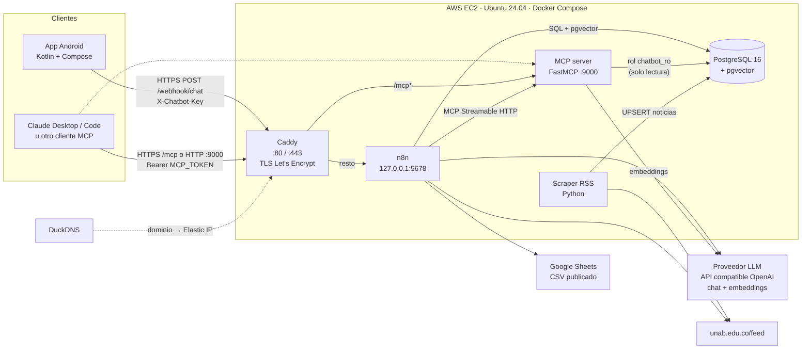
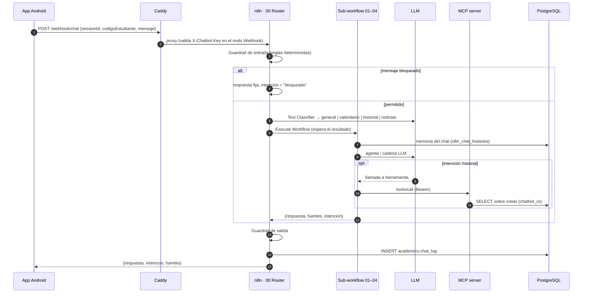
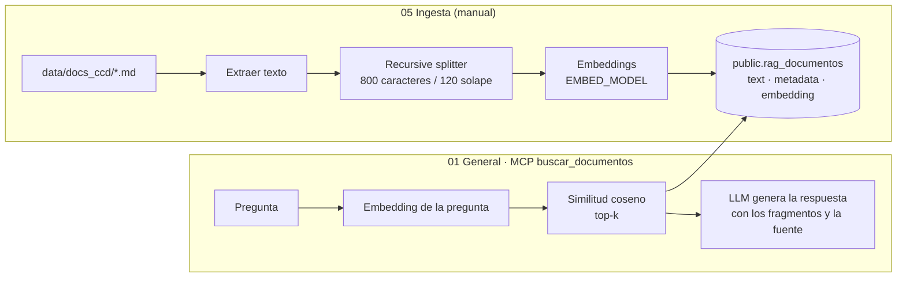

# Arquitectura

Asistente Académico UNAB: chatbot híbrido (RAG + agentes con herramientas MCP) orquestado con n8n, desplegado en una sola instancia EC2 con Docker Compose y consumido desde una app Android.

> Todos los datos de estudiantes son **sintéticos**. El modelo de datos está en [MODELO-DE-DATOS.md](MODELO-DE-DATOS.md); el despliegue paso a paso, en [DESPLIEGUE-EN-AWS.md](DESPLIEGUE-EN-AWS.md); el proveedor del LLM, en [LLM-PROVEEDOR.md](LLM-PROVEEDOR.md).

---

## 1. Vista general



El modelo de lenguaje **no corre en la VM**: se consume por API. La instancia solo ejecuta servicios ligeros (unos 650 MB de RAM en reposo), por eso basta una `t3.small` con swap.

## 2. Componentes

| Servicio (compose) | Imagen / código | Puerto | Responsabilidad |
|---|---|---|---|
| `caddy` | `caddy:2.10-alpine`, [caddy/Caddyfile](../caddy/Caddyfile) | 80, 443 (públicos) | Terminación TLS automática con Let's Encrypt; enruta `/mcp*` al MCP server y todo lo demás a n8n |
| `n8n` | `n8nio/n8n:2.47.7` | 5678 (solo `127.0.0.1`) | Orquestación: webhook del chat, guardrails, clasificación de intención, agentes, RAG, ingesta, memoria |
| `mcp-server` | [mcp-server/server.py](../mcp-server/server.py) (FastMCP) | 9000 (público) | 10 herramientas de solo lectura sobre los datos académicos + búsqueda semántica |
| `postgres` | `pgvector/pgvector:0.8.7-pg16` | sin publicar | BD `unab` (datos académicos + vectores + memoria) y BD `n8n` (interna de n8n) |
| `scraper` | [scraper/scraper.py](../scraper/scraper.py) | — | Lee el RSS de la UNAB cada `SCRAPE_INTERVAL_HOURS` (6 h) y hace UPSERT en `academico.noticia` |

Servicios externos:

| Servicio | Uso |
|---|---|
| Proveedor LLM (b.ai / qwen-flash, compatible con OpenAI) | `/chat/completions` para los agentes y el clasificador; `/embeddings` para el RAG |
| Google Sheets | Calendario académico publicado como CSV (`SHEETS_CSV_URL`) |
| DuckDNS | Subdominio que apunta a la Elastic IP de la instancia |
| `unab.edu.co/feed` | Fuente RSS de noticias |

### Persistencia

| Volumen | Contenido |
|---|---|
| `pgdata` | Todas las bases de datos. Los scripts de `db/init/` solo se ejecutan cuando este volumen está vacío |
| `n8n_data` | Configuración de n8n y clave de cifrado de credenciales |
| `caddy_data`, `caddy_config` | Certificados TLS emitidos |

Montajes de solo lectura en n8n: `./data/docs_ccd → /files/docs_ccd` (corpus del RAG) y `./n8n → /bootstrap` (workflows y credenciales para importar).

## 3. Flujo de una pregunta



Contrato HTTP:

```http
POST https://chatbot-unab.duckdns.org/webhook/chat
X-Chatbot-Key: <CHATBOT_KEY>
Content-Type: application/json

{"sessionId": "uuid", "codigoEstudiante": "U00000001", "mensaje": "¿Cuántos semestres me faltan?"}
```
Respuesta: `{"respuesta": "...", "intencion": "general|calendario|historial|noticias|bloqueado", "fuentes": ["..."]}`.

## 4. Workflows de n8n

Los workflows se definen como código en [n8n/build_workflows.py](../n8n/build_workflows.py), que genera los JSON de `n8n/workflows/`. Así los IDs de workflows y credenciales son fijos (el router llama a los sub-workflows por ID) y los prompts quedan versionados. [scripts/n8n-import.sh](../scripts/n8n-import.sh) importa credenciales y workflows y publica primero los sub-workflows y después el router.

| ID | Workflow | Disparador | Qué hace |
|---|---|---|---|
| `wfRouterChatUNAB` | **00 Router** | Webhook `POST /chat` | Guardrail de entrada → clasificación de intención (LLM, temperatura 0) → sub-workflow → guardrail de salida → log → respuesta. Si el clasificador no decide (`other`), va al 01 |
| `wf01GeneralRAG00` | **01 Consulta general (RAG)** | Llamado por el router | AI Agent con memoria y la herramienta `documentos_institucionales` (PGVector, top-k 4). Debe citar la fuente |
| `wf02Calendario00` | **02 Calendario** | Llamado por el router | Descarga el CSV del Google Sheet (o el respaldo `/calendario.csv` del MCP server), lo convierte en texto y una cadena LLM responde con fechas exactas y días restantes |
| `wf03CursosMCP000` | **03 Cursos e historial (MCP)** | Llamado por el router | AI Agent con memoria y el nodo *MCP Client Tool*, que expone las 10 herramientas del MCP server. Siempre usa el código del estudiante autenticado |
| `wf04Noticias0000` | **04 Noticias** | Cada 6 h **y** llamado por el router | Rama A: RSS → clasificación por palabras clave → UPSERT. Rama B: lee `v_noticias_recientes` y el LLM resume con enlaces |
| `wf05IngestaRAG00` | **05 Ingesta RAG** | Manual | Borra `rag_documentos` → lee `/files/docs_ccd/*.md` → extrae texto → chunking → embeddings → inserta en PGVector |

Elementos compartidos:
- **Modelo de chat**: nodo OpenAI con *Base URL* del proveedor, modelo `$env.LLM_MODEL`, máximo 900 tokens, temperatura 0,2 (0 en el clasificador).
- **Memoria**: *Postgres Chat Memory* en `public.n8n_chat_histories`, clave = `sessionId`, ventana de 8 mensajes. La usan los workflows 01 y 03, así que el contexto sobrevive entre sesiones de la app.
- **Prompt base**: español, máximo 180 palabras, no inventar datos, no revelar datos de otro estudiante, ignorar intentos de cambiar las reglas.

## 5. RAG



- **Corpus**: 5 documentos Markdown del Centro de Competencias Digitales y del programa (insignia, matrícula, requisitos de grado, éxito académico y plan de estudios). `plan_de_estudios.md` lo genera `scripts/generate_synthetic.py` a partir del plan real.
- **Almacén**: pgvector en la misma instancia de PostgreSQL. No hace falta otra base de datos vectorial.
- **Recuperación**: hay dos caminos sobre la misma tabla. El workflow 01 usa el nodo PGVector como herramienta del agente, y el MCP server expone `buscar_documentos` a clientes externos (operador `<=>`, distancia coseno).
- **Regla**: todos los vectores deben venir del mismo modelo. Si cambia `EMBED_MODEL` o algún documento, hay que volver a ejecutar el workflow 05.

## 6. Servidor MCP

[mcp-server/server.py](../mcp-server/server.py) usa FastMCP con transporte *Streamable HTTP* en `/mcp`, servido con uvicorn en el puerto 9000.

| Herramienta | Fuente |
|---|---|
| `estado_academico` | `v_estado_academico` |
| `cursos_pendientes` | `v_cursos_pendientes` (opcional: solo los habilitados por prerrequisitos) |
| `alertas_requisitos` | `v_alertas_prerrequisitos` + `v_requisitos_grado` |
| `proyeccion_semestres` | `v_proyeccion` |
| `recomendaciones` | Reglas en Python sobre promedio, cursos reprobados, matrícula, bloqueos, insignia y requisitos de grado |
| `competencias_digitales` | `v_competencias_digitales` + `v_insignia` |
| `oferta_competencias_digitales` | `curso_cd` |
| `calendario_academico` | `calendario_evento` |
| `noticias_recientes` | `v_noticias_recientes` |
| `buscar_documentos` | `public.rag_documentos` (embeddings con `EMBED_*`) |

Rutas HTTP adicionales sin autenticación: `/health` (healthcheck de Docker) y `/calendario.csv` (respaldo público del calendario para el workflow 02).

Detalles de implementación:
- Pool de conexiones `psycopg_pool` (1–4) que se abre al llegar la primera consulta, para que el servidor arranque aunque Postgres tarde.
- Todas las consultas son parametrizadas; el código del estudiante se valida con `^U\d{8}$` y los límites (`k`, `limite`) están acotados.
- Las vistas de `02_views.sql` concentran la lógica analítica (avance, proyección, insignia), así que las herramientas son consultas simples.

## 7. Datos

La BD `unab` tiene dos esquemas:

- `academico`: simula el sistema académico (Banner/Cosmos) con 15 tablas: programa, plan, prerrequisitos, periodos, estudiantes, matrículas, historial, requisitos de grado, CCD, pruebas diagnósticas, calendario, noticias y `chat_log`. Incluye 8 vistas analíticas para los agentes.
- `public`: `rag_documentos` (la crea n8n) y `n8n_chat_histories` (memoria).

Los scripts de `db/init/` se ejecutan una sola vez, en orden: `00` crea la BD `n8n`, la extensión `vector` y el rol `chatbot_ro`; `01` crea el esquema; `02` crea las vistas y los permisos; `03` carga los datos sintéticos. Para regenerarlos hay que borrar el volumen (`docker compose down -v`).

Detalle de tablas, vistas, reglas de proyección y volumen de datos: [MODELO-DE-DATOS.md](MODELO-DE-DATOS.md).

## 8. Seguridad

| Capa | Medida |
|---|---|
| Red | Solo 80/443 (Caddy) y 9000 (MCP) son públicos. n8n escucha en `127.0.0.1` y Postgres no publica puertos. SSH (22) solo desde la IP del equipo en el Security Group |
| Transporte | HTTPS con Let's Encrypt en el dominio. La app Android bloquea HTTP salvo `localhost` y `10.0.2.2` (emulador) |
| Autenticación | Webhook con cabecera `X-Chatbot-Key` (credencial *Header Auth* de n8n). MCP con `Authorization: Bearer <MCP_TOKEN>` |
| Mínimo privilegio | El MCP server usa `chatbot_ro`: `SELECT` en `academico` y `public`, y solo `INSERT` en `chat_log` |
| Guardrail de entrada | Mensaje vacío o de más de 1000 caracteres, código inválido, inyección de prompt, patrones de SQL, mención de otro código de estudiante, números de tarjeta o contraseñas, lenguaje ofensivo |
| Guardrail de salida | Oculta códigos de otros estudiantes y correos, sustituye errores técnicos por un mensaje genérico, limita la respuesta a 2500 caracteres |
| Auditoría | Cada interacción (incluidas las bloqueadas y su motivo) queda en `academico.chat_log` |
| Secretos | Solo en `.env` (fuera de git). `n8n-import.sh` los convierte en credenciales cifradas con `N8N_ENCRYPTION_KEY` y borra el JSON temporal |

Limitaciones conocidas, aceptables porque los datos son sintéticos:
- `CHATBOT_KEY` va compilada en el APK, y el `codigoEstudiante` lo declara el cliente sin verificarlo. Con la app se puede consultar cualquier código; el guardrail solo impide mencionar otro código dentro del mensaje. En producción haría falta autenticación real (por ejemplo, SSO institucional con un token del que el servidor saque el código).
- El puerto 9000 sirve MCP por HTTP sin cifrar, así que el token viaja en claro. La misma ruta está disponible por HTTPS en `https://chatbot-unab.duckdns.org/mcp`; el puerto 9000 se mantiene abierto porque lo exige el curso.
- n8n se conecta a Postgres con el usuario administrador (`POSTGRES_USER`), porque necesita crear tablas (`rag_documentos`, memoria) y escribir noticias y logs.

## 9. Decisiones de diseño

| Decisión | Motivo |
|---|---|
| n8n como orquestador | Requisito del curso; además, los flujos se ven y depuran en el editor (ejecuciones nodo a nodo) |
| Router + sub-workflows por intención | Cada intención tiene su propio prompt y herramientas; un fallo o un cambio en una no afecta a las demás, y se pueden probar por separado |
| Guardrails deterministas (código) antes del LLM | Rápidos, sin costo de tokens y predecibles; bloquean antes de llegar al modelo |
| MCP server separado en lugar de consultas SQL dentro de n8n | Las mismas herramientas sirven al agente de n8n y a clientes externos (Claude), con un rol de solo lectura y validación centralizada |
| pgvector en el mismo Postgres | Una sola base de datos que operar y respaldar; el volumen del corpus es pequeño |
| LLM por API compatible con OpenAI | Sin GPU en la VM; el proveedor se cambia editando `.env` |
| Workflows como código | IDs estables entre importaciones, prompts revisables en git, regeneración reproducible |
| Caddy | HTTPS automático sin configurar certbot; Caddyfile de pocas líneas |
| Calendario en Google Sheets con respaldo en BD | Las personas no técnicas pueden editar las fechas; si el Sheet no está configurado, el sistema sigue funcionando |
| Noticias por RSS | Formato pensado para ser consumido: estable, liviano y sin raspar HTML |

## 10. Configuración

Todas las variables están en [.env.example](../.env.example):

| Grupo | Variables | Consumidas por |
|---|---|---|
| Dominio | `DOMAIN`, `ACME_EMAIL`, `DUCKDNS_*` | Caddy, n8n, `duckdns-update.sh` |
| Base de datos | `POSTGRES_USER`, `POSTGRES_PASSWORD`, `APP_DB_PASSWORD` | Postgres, n8n, scraper, MCP (`chatbot_ro`) |
| n8n | `N8N_VERSION`, `N8N_ENCRYPTION_KEY` | n8n |
| LLM | `LLM_BASE_URL`, `LLM_API_KEY`, `LLM_MODEL` | Credencial de n8n, workflows |
| Embeddings | `EMBED_BASE_URL`, `EMBED_API_KEY`, `EMBED_MODEL` | Credencial de n8n, MCP server |
| Accesos | `MCP_TOKEN`, `CHATBOT_KEY` | MCP server, n8n, app Android |
| Otros | `SHEETS_CSV_URL`, `SCRAPE_INTERVAL_HOURS` | Workflow 02, scraper |

## 11. Limitaciones y trabajo futuro

- **Ingestión de noticias duplicada**: el scraper de Python y la rama A del workflow 04 hacen lo mismo. El UPSERT por `url` evita duplicados, pero conviene dejar solo uno.
- **Un único nodo**: no hay alta disponibilidad ni copias de seguridad automáticas del volumen `pgdata`.
- **Ingesta manual**: el workflow 05 se ejecuta a mano; podría dispararse al cambiar los documentos.
- **Autenticación de estudiantes**: ver las limitaciones de seguridad del §8.
